# Tutorial github

Para iniciar no uso do github, primeiro você deve clonar o projeto em https://github.com/noturfrnd/glpi-chat-bot, pra isso basta clicar no botao escrito <>CODE e seguir o passo a passo apresentado.

## Criando sua propria branch

Pra começar a trabalhar com o codigo, voce deve seguir um breve passo a passo que vai garantir que você tenha todas as ultimas alterações feitas por seus colegas no seu codigo e que possa trabalhar sem medo de perder suas mudanças

 - Primeiro, tenha certeza que voce esta na branch "main"
 isso vai garantir que você esta onde todos vao atualizar as mudanças trabalhada

### pela IDE (vsCode)

  - para saber em qual branch voce esta agora, basta olhar para o canto inferior esquerdo do vsCode 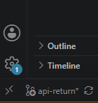 
  no meu caso "api-return" é a branch

  - Para mudar de branch basta clicar no nome, vai abrir no topo do vsCode uma lista de branchs, onde voce deve escoher "main" 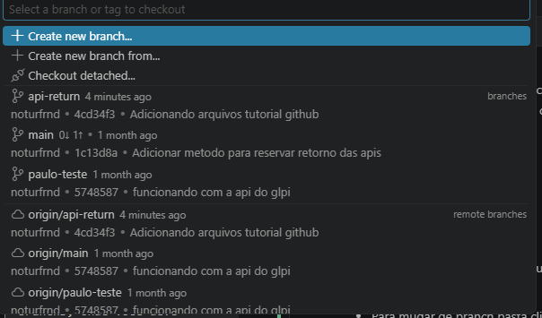 ao clicar em main, toda a mudança sera feita automaticamente

  - agora voce precisa atualizar as mudanças que estão na main da nuvem para o seu codigo local usando o botão "Pull" na terceira aba do vsCode "source control" 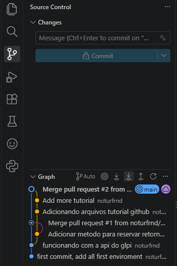 ( segunda seta pra baixo, selecionado na imagem)

  - apos isso, sua branch main tera todas as mudanças atualizadas, agora voce deve criar uma branch para que voce mesmo faça as suas mudanças, pra isso, basta clicar novamente no nome da branch no canto inferior direito e ao aparecer o pop-up no todo do vsCode selecionar a opção "create new branch from"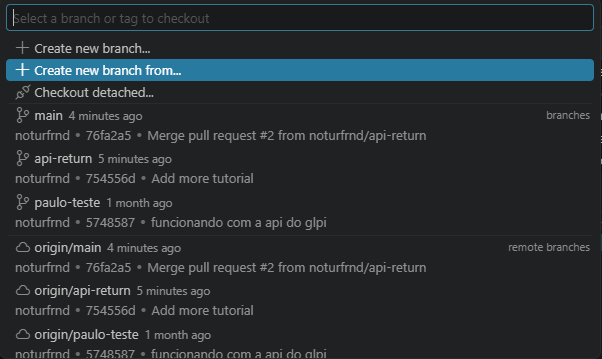 e então selecionar a primeira opção "HEAD" 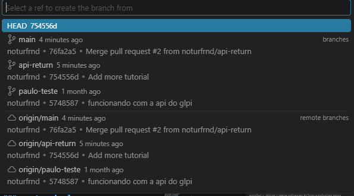 e digitar o nome da sua nova branch 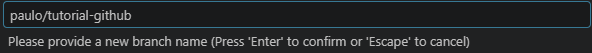 depois basta apertar enter e sua branch nova esta criada

  - mas esta branch ainda nao esta na nuvem, entao no canto inferior esquerdo clique na nuvem ao lado do nome da branch 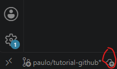

  - Agora, quando finalizar suas alterações voltamos a terceira aba lateral do vsCode, a "source control", e vemos as mudanças que ainda nao foram adicionadas a nuvem 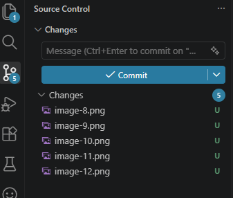

    - para adicionar essas mudanças é necessario fazer um "commit", para isso escreva a mensagem do commit logo acima dessas mudanças, e ao passa o mouse em cima do nome "changes" vera um sinal de +, clique nele pra adicionar as mudanças ao commit 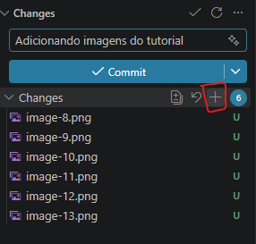

    - depois basta clicar no botao azul escrito "commit"

    - e no mesmo lugar que fizemos o "pull" agora precisa fazer o "push" representado pela seta pra cima 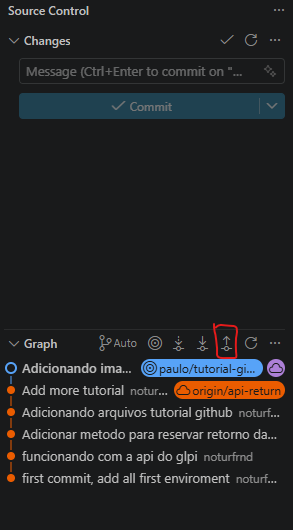

### no terminal

   - para isso, abra o powershell, gitbash ou prompt de comando a partir do arquivo do codigo, o promp aberto ira se parecer com isso 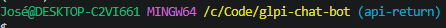 para o gitbash, ja para o powershell: 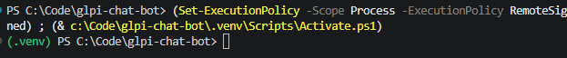
   - No caso do gitbash o texto em azul indica a branch que você esta, no meu caso (api-return) tenha certeza de estar na main
   - no caso do powershell você pode utilizar o comando git status para visualizar sua branch atual
   - caso nao esteja na main, basta executar o comando `git checkout main`

 - No gitbash, powershell ou prompt de comando, execute o comando `git pull` para que toda a atualização da nuvem seja baixada para o seu codigo local

 - enfirm, basta que neste mesmo terminal você execute o comando `git checkout -b "Nome da branch nova"` adicionando o nome da branch que deseja criar,
 atenção para criar branchs com nomes que façam sentido, se Paulo for trabalhar por exemplo no endpoint de aprovação seria 
 `git checkout -b "paulo/endpoint-aprovacao"`

 - depois disso voce ira notar no canto do seu editor (VSCODE) que o nome da branch mudou
 
 - ao terminar de fazer as alterações voce pode adicionar na nuvem as suas mudanças com os seguintes comandos: 

   - git status (esse comando vai mostrar os arquivos modificados)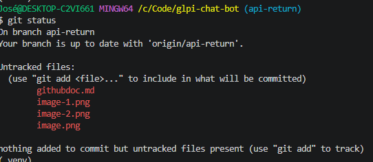
   - git add . (esse comando vai adicionar todas as modificaçoes aos arquivos que serão enviados a nuvem)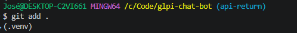
   - git commit -m "mensagem" (esse comando é obrigatorio e vai pegar todos os arquivos marcados pra serem enviados à nuvem e encapsula-los em um 'commit', escolha a mensagem do commit com sabedoria)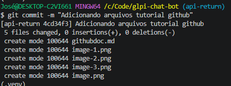
   - git push (esse comando ira pegar o commit criado anteriormente e adicionara ele à nuvem do github, depois desse, o codigo ja é acessivel atraves do site github)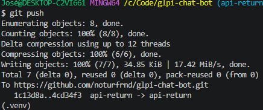